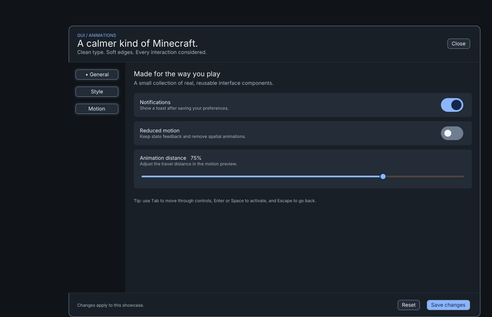

# Gui-animations

An AI agent toolkit for building smooth, modern Minecraft Java interfaces:
clean sans-serif text, anti-aliased shapes, consistent spacing, and responsive
opening, closing, click, and popup animations.

**0.1.0 · Minecraft 26.1.2 · Fabric · JDK 25**

Includes a real ModernUI showcase, reusable Java components, a shared design
system, and one self-contained `minecraft-gui` skill for your coding agent.
See the [verification report](docs/verification-report.md) for observed coverage
and remaining hardware/platform limits.



[Watch the in-game interactions](docs/media/interactions.mp4).

## Start here

- [Get started](docs/getting-started.md): run the showcase, install the skill, or create a new mod starter.
- [Use it in your client or mod](docs/USAGE.md): how the main skill and shared code work together.
- [Compatibility](docs/compatibility.md): exact dependency pins and coordinate contract.
- [Verification](docs/verification-report.md): build, installation, and runtime evidence.
- [Examples and research](docs/RESEARCH.md): projects worth studying and their tradeoffs.
- [Design direction](docs/DESIGN.md): typography, components, motion, and quality standards.
- [Build plan](docs/PLAN.md): architecture and milestone history.

## Included

| Part | Purpose |
| --- | --- |
| [Main skill](.agents/skills/minecraft-gui/SKILL.md) | Design → implementation → motion → review, with local references and actual source templates. |
| [Installer](scripts/install.py) | Codex and Claude Code project setup; preserves rules and detects update conflicts. |
| [Design system](design/README.md) | Machine-readable tokens, component specifications, licensed Inter font, schema and contrast checks. |
| [Motion core](reference/core/README.md) | Monotonic, interruptible transitions with reduced-motion and lifecycle tests. |
| [ModernUI adapter](adapters/fabric-modernui/build.gradle) | Shared theme, animated controls, settings storage, and screen composition. |
| [Showcase mod](examples/showcase-mod/build.gradle) | A settings screen with tabs, toggles, slider, modal, tooltips, toasts, and local persistence. |

## Install into your project

Clone this repository, then run from the checkout:

```sh
python3 scripts/install.py --project /path/to/your-client --agent codex
```

Use `--agent claude` for Claude Code. Python 3.10+ is required. To import the
complete runnable demo into a new project, also add `--starter`.

Then ask your coding agent inside **your client/mod project**:

> Use minecraft-gui to build my settings menu. Reuse the shared theme and
> components, add smooth animations, and connect the controls to my settings.

The skill teaches the agent; the imported Java components and renderer run in
Minecraft. The default installation preserves your existing build/source files.
Later screens reuse the same project theme and components.

## Run the showcase

With JDK 25 installed:

```sh
./gradlew build
./gradlew :examples:showcase-mod:runClient
```

Press **F8** at the title screen or in game. Escape closes the top layer and
returns to the previous screen. Use `gradlew.bat` on Windows.

The [getting-started guide](docs/getting-started.md) includes the full test suite,
safe update behavior, standalone starter setup, and agent prompt examples.

## License

Original repository content is MIT licensed. Fonts, the Gradle wrapper, and
external libraries retain their own terms; see [third-party notices](THIRD_PARTY_NOTICES.md).
